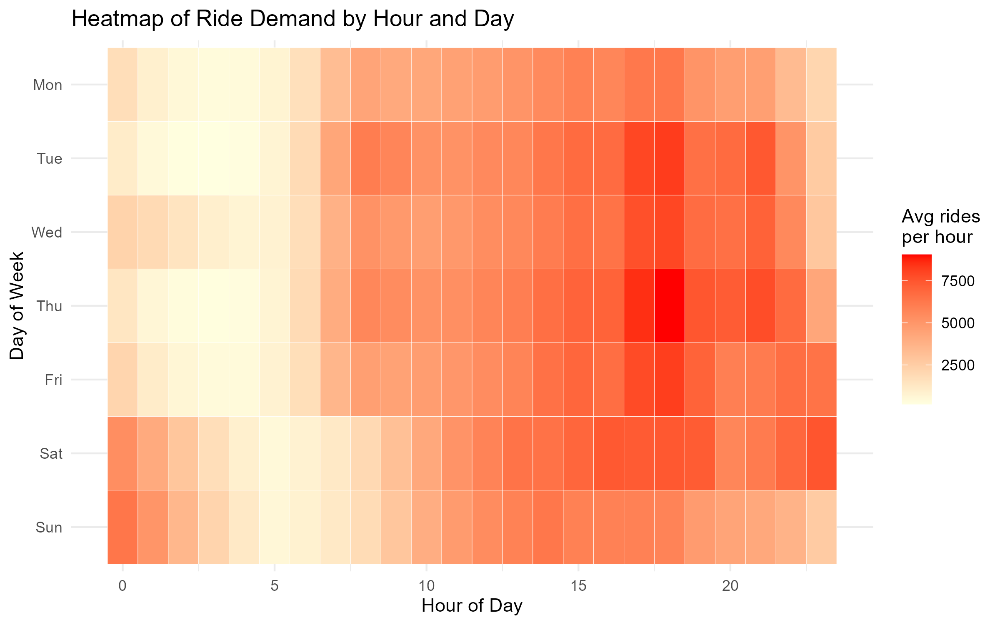
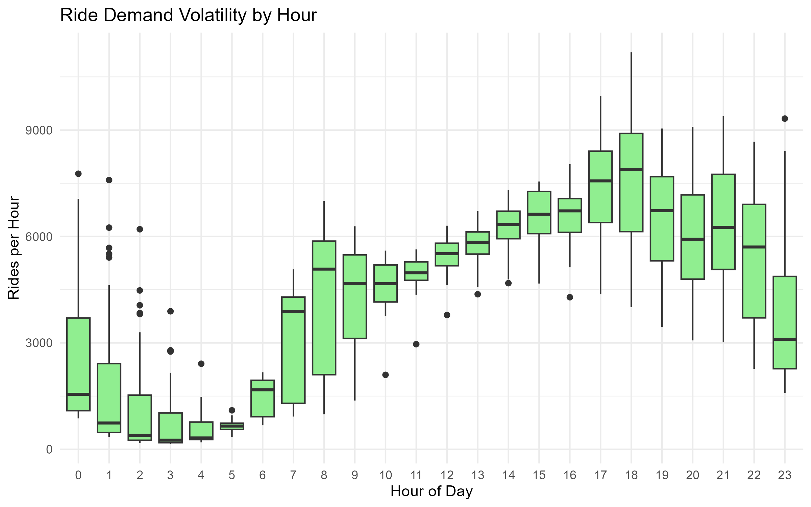
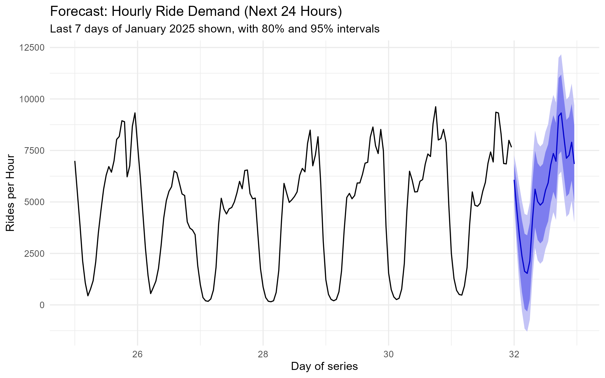
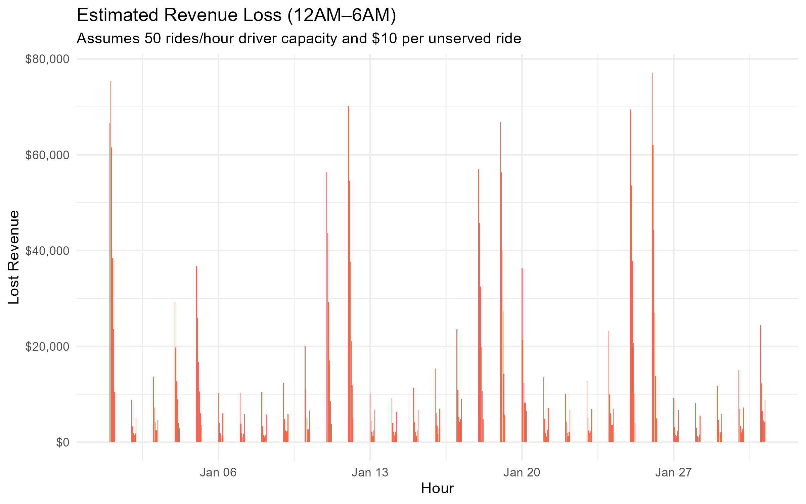

# NYC Taxi Demand Forecasting

**Forecasting hourly NYC yellow-taxi demand and estimating revenue lost to overnight driver shortages**, using January 2025 TLC trip records and R.

The project answers two questions:

1. **Can hourly ride demand be forecast from historical data?** An ARIMA model with 24-hour seasonality is fitted on the hourly ride counts. Its accuracy is measured with rolling 24-hour forecasts over the final week and compared with two simple baselines.
2. **How much revenue is lost when there aren't enough drivers?** A simulation caps overnight capacity (12 AM–6 AM) and values every unserved ride at an assumed fare.

## Contents

- [Quick start](#quick-start)
- [Method](#method)
- [Outputs](#outputs)
- [Findings](#findings)
- [Assumptions and limitations](#assumptions-and-limitations)
- [Project structure](#project-structure)
- [About](#about)

## Quick start

Requires **R 4.0+**. Missing packages (`tidyverse`, `lubridate`, `forecast`, `data.table`, `arrow`) are installed automatically on first run.

```bash
git clone https://github.com/Loya-ar/nyc-taxi-demand-forecasting.git
cd nyc-taxi-demand-forecasting

# Download the January 2025 yellow-taxi data (about 59 MB) into data/
curl -o data/yellow_tripdata_2025-01.parquet https://d37ci6vzurychx.cloudfront.net/trip-data/yellow_tripdata_2025-01.parquet

Rscript analysis.R
```

You can also run it from RStudio with `source("analysis.R")`, using the project folder as the working directory. To use a different TLC file, including a CSV export, pass its path: `Rscript analysis.R data/other_file.csv`. See [`data/README.md`](data/README.md).

## Method

| Step | What the script does |
|---|---|
| **Load** | Reads only the three columns it needs (pickup time, distance, fare) from Parquet or CSV |
| **Clean** | Keeps pickups inside January 2025 (TLC files include a few stray timestamps from other months and years) and drops trips with zero distance or fare |
| **Aggregate** | Counts rides per hour. Hours with no rides are kept as 0, so the series has exactly 744 hourly points with no gaps |
| **Validate** | For each of the last 7 days, fits on everything before that day and forecasts its 24 hours. Compares ARIMA, ARIMA with weekly Fourier terms, and two naive baselines (same hour yesterday, same hour last week) on MAE, RMSE and MAPE |
| **Forecast** | Refits on the full month and forecasts the next 24 hours with 80% and 95% intervals |
| **Simulate** | For 12 AM–6 AM, `unmet = max(rides − 50, 0)` and `lost revenue = unmet × $10`, summarised per hour and per weekday |
| **Visualise** | Forecast, hourly volatility boxplot, overnight revenue loss, and a weekday × hour demand heatmap |

All settings (study period, hold-out length, driver cap, fare) are at the top of [`analysis.R`](analysis.R).

## Outputs

Everything is written to `output/` (git-ignored):

| File | Contents |
|---|---|
| `forecast_accuracy.csv` | Average MAE, RMSE and MAPE of the four models over the 7 rolling forecasts |
| `hourly_rides.csv` | The cleaned hourly series (744 rows) |
| `revenue_loss_by_weekday.csv` | Average and total simulated overnight loss for each weekday |
| `chart_forecast.png` | Last week of demand plus the 24-hour forecast |
| `chart_boxplot.png` | Spread of rides per hour across the month, by hour of day |
| `chart_lost_revenue.png` | Simulated lost revenue for each overnight hour |
| `chart_heatmap.png` | Average rides per hour by weekday and hour |

## Findings

From a full run on the January 2025 TLC file: **3,475,226 trips**, of which **3,253,842 (93.6%)** remain after cleaning.

### Demand patterns



- Demand peaks around **5–7 PM** (about 7,600 rides an hour at 6 PM, averaged over the month) and bottoms out around **4 AM** (about 580).
- On **Friday and Saturday nights** demand stays high past midnight, so Saturday and Sunday mornings are the busiest overnight hours.



### Forecast accuracy

Rolling 24-hour forecasts over the last 7 days of January:

| Model | MAE | RMSE | MAPE |
|---|---:|---:|---:|
| **Naive: same hour last week** | **553** | **771** | **25.1%** |
| ARIMA + weekly Fourier terms | 722 | 1,041 | 38.0% |
| ARIMA, daily seasonality | 834 | 1,175 | 34.7% |
| Naive: same hour yesterday | 979 | 1,412 | 62.8% |

- ARIMA beats the "same hour yesterday" baseline by about 15% on MAE, so it does learn the daily cycle.
- **A plain "same hour last week" forecast beats every model.** Demand has a strong weekly pattern (weekends look very different from weekdays), and one month holds too few weeks for the models to learn it well. Adding weekly Fourier terms helps ARIMA but doesn't close the gap.
- MAPE is inflated in overnight hours, where a few hundred rides make small errors look large; MAE is the fairer comparison here.



### Overnight revenue loss (simulation)

With a cap of 50 rides an hour and $10 per unserved ride, the simulated loss averages **$12,956 per overnight hour** ($2.41M for the month), highest on Saturday and Sunday mornings:

| Night (12–6 AM) | Avg loss per hour | Total for the month |
|---|---:|---:|
| Mon | $7,061 | $169,460 |
| Tue | $4,262 | $102,290 |
| Wed | $12,761 | $382,820 |
| Thu | $5,255 | $157,660 |
| Fri | $8,499 | $254,980 |
| Sat | $25,120 | $602,870 |
| Sun | $30,825 | $739,790 |

Wednesday is high because January 1, 2025 was a Wednesday, and the hours after New Year's Eve are among the busiest of the month.



> **Note on the course report:** the [project report](docs/report.pdf) estimated $300–$400 per hour and about 7 million trips. Neither matches a full run on the January 2025 file. City-wide demand averages about 1,350 rides per overnight hour, so a 50-ride cap leaves almost all of it unserved and the loss runs into thousands of dollars per hour. The figures above replace the report's.

## Assumptions and limitations

- **The revenue-loss figures come from assumptions, not observed shortages.** The data records only completed trips, so real unmet demand isn't visible. The result scales directly with both settings:
  - The 50-rides-per-hour cap is far below city-wide overnight demand (every overnight hour in January exceeds it). It would make more sense per pickup zone or for a single fleet.
  - The real average fare in January 2025 was **$18.22**, not $10. Using it would raise the loss estimate by about 80%.
- **One month of data.** The model sees daily and weekly patterns but no seasonality across the year, holidays or weather.
- **City-wide totals.** Demand isn't broken down by borough or pickup zone.

## Project structure

```
nyc-taxi-demand-forecasting/
├── analysis.R          # Full pipeline: load, clean, validate, forecast, simulate, plot
├── data/
│   └── README.md       # Where to get the TLC trip file (data itself is git-ignored)
├── docs/
│   ├── report.pdf      # Course report
│   └── figures/        # Charts from the January 2025 run, used in this README
└── output/             # Created by the script (git-ignored)
```

## About

Built by **Arjun Loya** for *INFO6105: Data Science Engineering Methods & Tools* at Northeastern University, March 2025. There's a video walkthrough on [YouTube](https://www.youtube.com/watch?v=4gnVIXm6WPQ).

Data: [NYC Taxi & Limousine Commission Trip Record Data](https://www.nyc.gov/site/tlc/about/tlc-trip-record-data.page).
